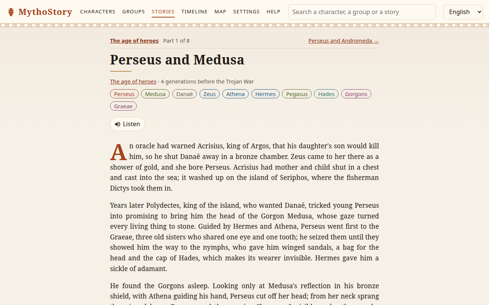
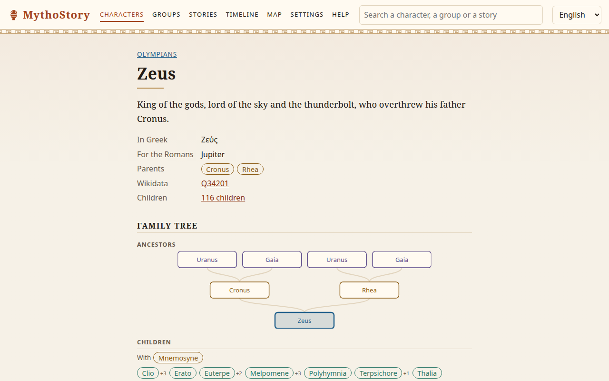
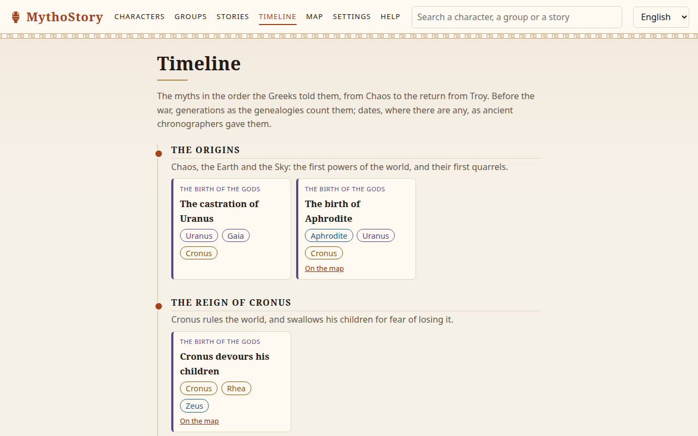
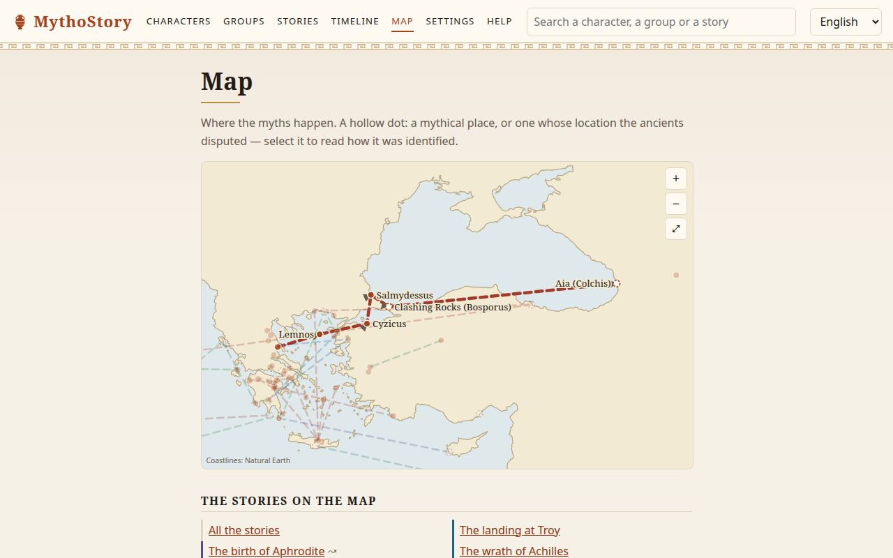
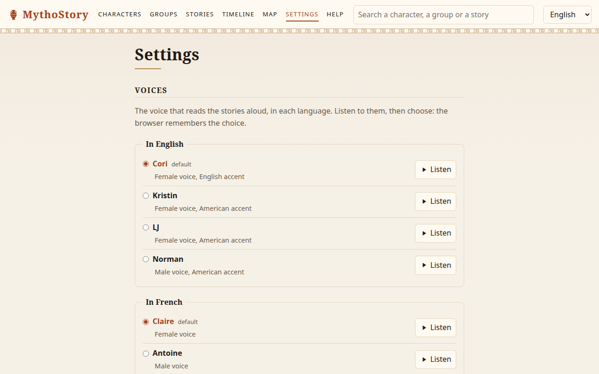
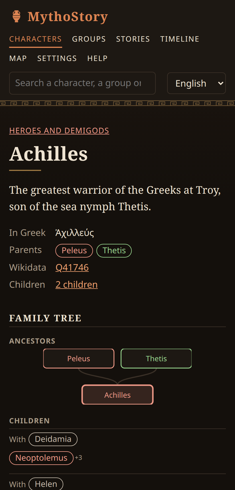
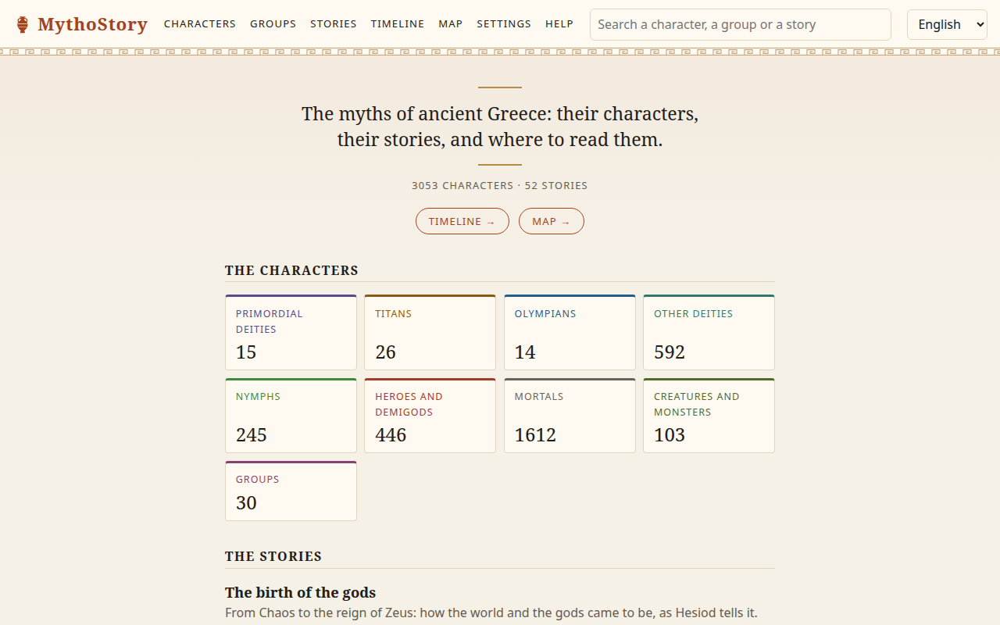

# MythoStory

[](LICENSE)


**The myths of ancient Greece, to read, to listen to and to wander through.** MythoStory gathers **the stories**
— from the birth of the gods to the fall of Troy and the return of Odysseus —, **the characters** who appear in them
— gods, Titans, nymphs, heroes, mortals, monsters: 3,000 of them —, and **the groups** they form — the Argonauts, the
Muses, the Seven against Thebes… One click leads from a story to its characters, from a character to their family,
their groups and their other stories, and from one episode of a cycle to the next. **In English and in French.**

It runs on your computer or your phone, **offline**: no account, no ads, nothing sent anywhere. Only the links to
the ancient texts, Wikipedia, articles and videos lead to the web.

**Contents**

- [**What it does**](#what-it-does): the stories, the characters and their families, the timeline, the map, the
  voices, in screenshots
- [**Download**](#download): for Linux, Windows and Android
- [**Using it**](#using-it): starting it, its port, its options, its log
- [**Where the content comes from**](#where-the-content-comes-from): the ancient sources, Wikidata, the map, the
  voices
- [**The API**](#the-api): the catalog, the voices and the page's addresses, for your own programs
- [**Build it yourself**](#build-it-yourself): from the sources; how MythoStory is made is in
  [docs/DEVELOPING.md](docs/DEVELOPING.md)
- [**Licence**](#licence)

## What it does

- **52 stories, each one summarised and sourced**: who tells it (Homer, Hesiod, Ovid, Apollodorus…), with a link
  to read the ancient text online, and to Wikipedia, articles and videos about it. The stories form cycles — the
  birth of the gods, the age of heroes, the Trojan War, the Odyssey… — read in order, part after part.

  

- **3,053 characters**, each with their name in Greek and for the Romans, their parents, their children and their
  **family tree**, the groups they belong to and the stories they appear in. The characters come from Wikidata.

  

- **A timeline** of the myths in the order the Greeks told them, from Chaos to the return from Troy, and **a map**
  of where they happen: each story's journey drawn on it, like the Argonauts' to Colchis below.

  

  

- **The stories read aloud**: a *Listen* button on every story, or all the stories one after the other. On a
  computer, natural voices that run offline (Piper): Cori, Kristin, LJ and Norman in English, Claire and Antoine in
  French. On a phone, the phone's own voices.

  

- **Search** across characters, groups and stories, from every page; **English or French** at any time; **a dark
  look** that follows the system's; and the same page on a phone:

  

The home page counts what is inside:



## Download

The ready-to-run builds are on the [**Releases page**](https://github.com/j4ckk0/MythoStory/releases/latest):

| File | For | How to start it |
|---|---|---|
| `mythostory-<version>-linux.tar.gz` | Linux (x86_64) | unpack it anywhere, run `./mythostory.sh` |
| `mythostory-<version>-windows.zip` | Windows (64-bit) | unzip it anywhere, run `MythoStory.exe` (not yet tried on Windows: say what fails) |
| `mythostory-<version>-android.apk` | Android 8.0 or later | open it on the phone, and allow installing it |

Nothing to install on a computer: each archive carries its own Java runtime, Piper and its voices. To build it
yourself instead: [Build it yourself](#build-it-yourself).

## Using it

**On a computer**, MythoStory is a small local server: started, it opens your browser on `http://127.0.0.1:8090/`,
and the browser is its window. Nothing listens beyond this computer, and it stops by itself once its last page is
closed (`--keep-alive` keeps it serving; Ctrl+C then). Started again while it runs, it opens the running one's page.

- `mythostory.ini`, beside `mythostory.jar`, sets the port (`port=`, 8090) and the interface (`host=`, 127.0.0.1:
  this computer only; 0.0.0.0 for the network).
- The command line wins over it: `--port N`, `--host H`, `--no-browser`, `--keep-alive`, `--piper DIR`,
  `--voices DIR`, `--help`.
- The log: `~/.mythostory/logs/mythostory.0.log`. The voices' credits: `VOICES.md`.

**On Android**, the same server runs inside the app and shows the same page; everything stays on the phone. The
stories are read with the phone's own text-to-speech voices (Settings › Text-to-speech).

## Where the content comes from

- **The stories** — 52, in 7 cycles — are summarised in our own words, never copied. Each cites at least one ancient
  source, with the passage and a link to read it online: Homer, Hesiod, Apollodorus, Ovid, Aeschylus, Sophocles,
  Euripides, Pindar, Apollonius of Rhodes, Virgil, Hyginus… in English from the Theoi Classical Texts Library, the
  MIT Internet Classics Archive and LacusCurtius, in French from Wikisource (Leconte de Lisle, Nisard, Clavier).
- **The characters** — 3,053 —: 166 written for MythoStory, and 2,887 imported from **Wikidata** (CC0): every
  character of Greek mythology with a Wikipedia article in English or French, with its names, its Greek name, its
  kind, its parents, a description, and links to Wikipedia and the Theoi Project.
- **The groups** — 30, from the Argonauts to the suitors of Penelope —, their members from the ancient lists.
- **The timeline** follows the genealogies, generation by generation before the Trojan War; its only dates are the
  ancient chronographers' (the Parian Chronicle, Eratosthenes), never ours.
- **The map**: 73 places, their coordinates from Wikidata, the coastlines from **Natural Earth** (public domain). A
  mythical place, or one whose location the ancients disputed, says who identified it with what.
- **The links**: 5,483, to Wikipedia, articles and videos, in English and French, all checked
  (`scripts/linux/check-links.sh`).
- **The voices**: each trained from scratch on free recordings (LibriVox, Multilingual LibriSpeech), listed with their
  licences in [`VOICES.md`](desktop/src/dist/files/VOICES.md).

The data itself is JSON, in [`core/src/main/resources/data/`](core/src/main/resources/data/); its format and its
checks are in [docs/DEVELOPING.md](docs/DEVELOPING.md#the-catalog).

## The API

| Method | Path           | Answer                                                                            |
|--------|----------------|-----------------------------------------------------------------------------------|
| GET    | `/api/info`    | `{name, version, platform, languages, voices}`: platform is `desktop` or `android` |
| GET    | `/api/catalog` | the whole catalog, every language in it: `{characters, groups, stories, cycles, eras, places}` |
| GET    | `/api/speech?lang=&voice=&text=` | a text of 1 to 1000 characters read aloud, as WAV, by that voice or the language's default (the desktop's Piper; `voices` in `/api/info` says which); 404 without a voice for the language, 400 for a bad text |
| GET    | `/api/licences` | `{embedded, libraries}`: what the help page lists                              |
| GET    | `/api/session` | a page's session: a WebSocket, its first message the session's id                 |
| POST   | `/api/session/{id}/closed` | the page has gone (a beacon): the desktop stops once its last page has   |

The API answers the page only: a request a browser marks as sent from another site (`Sec-Fetch-Site`), or whose
`Origin` is not the server's, gets 403, and so does any request naming another host than this computer while the
server listens on loopback (DNS rebinding). Requests without those headers (curl, the scripts) pass.

The page's own addresses — the Angular routes, which any other path serves `index.html` for: `/characters`
(`?kind=`, `&letter=`), `/characters/:id`, `/groups`, `/groups/:id`, `/stories`, `/stories/:id`, `/timeline`, `/map`
(`?story=`, `?place=`), `/search?q=`, `/settings`, `/help`. Under `/api` or for a missing file (a dot in its name),
404 instead, and `index.html` is never cached.

The catalog (about 1.7 MB, 300 kB gzipped) holds every language at once. Its records refer to each other by id, a slug
that is also the page's address (`zeus`, `/characters/zeus`); the format is in
[docs/DEVELOPING.md](docs/DEVELOPING.md#the-catalog). For example, with MythoStory running:

```bash
curl -s http://127.0.0.1:8090/api/info
curl -s http://127.0.0.1:8090/api/catalog | jq '.characters[] | select(.id == "zeus") | .name'
curl -s -o zeus.wav "http://127.0.0.1:8090/api/speech?lang=en&voice=en-cori&text=Zeus%20is%20the%20king%20of%20the%20gods."
```

## Build it yourself

On Linux (x86_64), or on Windows with the same scripts as `scripts\windows\*.bat`; `curl`, `tar` and `unzip` at
hand (on Windows, `jtools-1.6.1\install.bat --no-project` for the first step):

```bash
# once: JToolsFramework 1.6.1, the build's parent (jtools-parent), into ~/.m2 - it is not on Maven Central
curl -fLO https://github.com/j4ckk0/JToolsFramework/releases/download/v1.6.1/jtools-1.6.1.zip
unzip -q jtools-1.6.1.zip && jtools-1.6.1/install.sh --no-project
git clone https://github.com/j4ckk0/MythoStory.git && cd MythoStory
scripts/linux/setup.sh                    # once: the JDK, Maven, Node.js, Piper and its voices into external/
git config core.hooksPath .githooks       # once: scripts/linux/ci.sh runs before every push (git push --no-verify skips it)
scripts/linux/run.sh                      # build if needed, start, open the browser on http://127.0.0.1:8090/
```

For the Android app: `scripts/linux/setup.sh --android` (the Android SDK, about a gigabyte), then
`scripts/linux/run-android.sh` with a phone plugged in, or `scripts/linux/setup.sh --emulator` and
`scripts/linux/emulator.sh` for the emulator. On Windows, `setup.bat` deploys Piper and its voices too, but has not
been run on Windows yet: say what fails.

`scripts/linux/package.sh` makes the Linux and Windows archives and the APK in `releases/`. The rest — the
architecture, the data's format and checks, i18n, the externals, building, running, the emulator, packaging and
signing — is in [docs/DEVELOPING.md](docs/DEVELOPING.md).

## Licence

MythoStory — its code, its data and the summaries written for it — is licensed under the
[Apache License, Version 2.0](LICENSE). [`NOTICE`](NOTICE) lists everything it holds or ships that it did not
write, where it comes from and on what terms: the characters from Wikidata (CC0), the coastlines from Natural
Earth (public domain), JToolsFramework's devkit scripts (Apache-2.0), and, in the builds, the page's and the
server's libraries, the Java runtime, Piper and its voices. The Linux and Windows archives carry both files, and
`piper/licences/` the licence texts of Piper's components, which Piper's own archive leaves out, with where eSpeak
NG's source code is ([`desktop/src/dist/piper-licences/`](desktop/src/dist/piper-licences/README.txt)).

Android, Windows, Linux, Java, Wikipedia, Wikidata, YouTube, GitHub and the other names this README uses are
trademarks of their owners, named only to say what MythoStory runs on, is built with or links to; MythoStory is not
affiliated with any of them. `NOTICE` names the owners.
